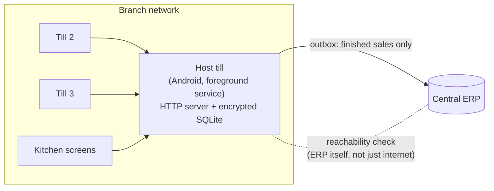

# Selling through outages: offline and LAN mode for a production POS

**App:** CNDroid POS, a Flutter point-of-sale running on certified Android fiscal devices
**My role:** only developer on the app (Dec 2025 – Jul 2026), then part-time lead (Jul – Oct 2026)
**Scale:** used by 200+ restaurants and 350+ distributors on offline and LAN modes, within an ecosystem of 700+ businesses

---

## The problem

The POS talks to a central ERP. When the ERP was unreachable, selling stopped, even when the shop's internet was fine. The existing offline mode was a simple key-value cache that could lose data on a power cut, and it only covered a single till.

Restaurants need more than one till to keep working: waiters, cashiers and kitchen screens all share the same open orders. A single-device offline mode doesn't solve that.

## Constraints

- **Money and tax are involved.** Every sale must reach the ERP exactly once and agree with the fiscal printer's record.
- **Unreliable power and networks.** Devices get switched off mid-sale; Wi-Fi can return while the ERP is still down.
- **Mixed branches.** Some branches have a local PC that can act as a server; many have only Android tills.
- **Online mode must not regress** for the businesses that never go offline.

## Architecture

The app runs in one of four modes: **online**, **offline** (single till), **LAN via a branch PC**, or **LAN via an Android till**.

- **Storage:** moved local data from a key-value cache to **encrypted SQLite**. Existing data migrates as a stream, so it never sits in memory all at once.
- **Host till:** one Android till runs a small **HTTP server with its own encrypted database**. Other tills and kitchen screens connect to it over the local network.
- **Outbox:** queued sales are sent on start-up, on recovery and on a regular heartbeat.
- **Kitchen feed:** kitchen screens and incoming online orders are served from the host till, so the kitchen keeps working offline too.

## Key decisions and trade-offs

1. **Test the ERP, not the internet.** A connectivity check says "online" when Wi-Fi works but the ERP doesn't. The app checks the ERP directly, and the verdict is debounced, so one failed call doesn't flip the mode.
2. **Never switch modes mid-sale.** A mode change waits until any open sale is closed, to avoid splitting one order across two data stores.
3. **Optimistic concurrency on orders.** Each order carries a version number. A stale write from a second waiter gets a conflict reply instead of silently overwriting the first.
4. **Only finished sales sync.** Open tables stay local until they're closed. Cash sales wait for settlement; credit sales don't. This keeps the ERP free of half-finished orders.
5. **Durability over speed.** After a data-loss bug on power-off, I turned on write-ahead logging with full sync. Writes got slightly slower; sales stopped disappearing.
6. **Keep the host alive on Android.** Android aggressively kills background work, so the server runs as a **foreground service with a wake lock**. Android 14 required declaring a specific service type.
7. **Port, don't reinvent.** A colleague had already built the PC version of the branch server in .NET. I ported its sync rules to Android, so both branch types behave the same.

## Problems I hit

- **Duplicate vouchers** caused by parallel sync runs. Tracked down and fixed.
- **Wi-Fi back, ERP still down.** The debounced ERP check above came out of this.
- **Drift between the PC and Android servers.** Two fixes were needed to bring the Android server back in line with the PC behaviour.

## Results

- Restaurants and distributors keep trading through internet and ERP outages.
- About 100 restaurants run whole branches on LAN mode with no central server.
- The branch server is covered by 71 automated tests, part of the POS's first test suite (about 200 tests).

## What I'd do next

- **Shared contract tests** that both the PC and Android servers must pass, so they can't drift apart.
- **One data-source interface per mode**, instead of mode checks spread across the code.
- **Split the largest view models** in the sale flow into small, tested units (pricing, saving, printing, sync).
