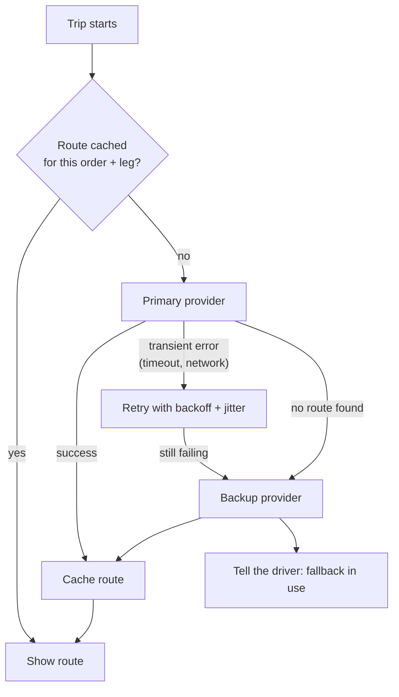

# Routing that doesn't strand drivers: dual-provider fallback

**App:** HuluBeje Delivery, a Flutter driver app for restaurant and retail deliveries
**My role:** primary owner of the app (Nov 2025 – Apr 2026)

---

## The problem

Drivers rely on in-app turn-by-turn directions. The app called a single routing endpoint. When that provider failed or timed out, the driver got no route at all, mid-delivery.

A second problem: once a driver accepted an order, the app stopped listening for changes. If the customer cancelled or changed the address, the driver didn't find out.

## Architecture

- **Two providers behind one model.** The two providers return different formats. A single route model detects the format and picks the right parser, so the UI never knows which provider answered.
- **Per-order, per-leg cache.** Routes for both legs (to the branch, then to the customer) are prefetched when a trip starts.
- **Remote switch.** A remote config flag can change the primary provider without an app release.

## Key decisions and trade-offs

1. **Retry only transient errors.** Timeouts and network errors are retried with exponential backoff and jitter. A "no route" answer is a real result, so it goes straight to the backup provider instead of wasting retries.
2. **Tell the driver.** When the backup is in use, the driver sees a short notice, so a slightly different route doesn't look like a bug.
3. **Clear the cache on change.** Cancellation, timeout or an address change clears the cached route, so a driver never follows a stale one.

## Related work: trips that react to changes

- Split one polling timer into two: one watches for new assignments when idle, the other watches the active order during a trip.
- Added push notifications as a faster signal for the same changes.
- A small fingerprint of each order (status plus address) skips repeat work when push and polling report the same change.
- On an address change: update the order, clear the cached route, fetch a new one, and update the map and ETA. On a cancellation: clear the trip and return to waiting for work.

## Results

- Drivers keep getting directions when the main routing provider fails.
- Drivers no longer deliver orders that were cancelled or re-addressed mid-trip.

## What I'd do next

- **Re-route the customer leg from the branch on arrival**, instead of prefetching both legs from the driver's start point.
- **Off-route detection**, to re-route when a driver leaves the suggested path.
- **Split the large driver BLoC** into trip, location and routing BLoCs, with tests starting from the order-change logic.
