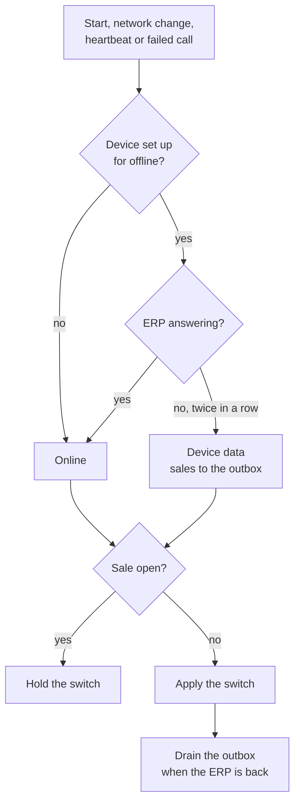

# "Saved" should mean saved: offline mode that survives power cuts and a flaky server

**App:** CNDroid POS, a Flutter point-of-sale on Android fiscal devices
**My role:** only developer on the app, then part-time lead. I designed and built everything described here (releases 2.0.49 – 2.0.54).
**Scale:** offline and LAN modes keep 200+ restaurants and 350+ distributors selling when the ERP is unreachable

Case study [01](01-offline-lan-pos.md) covers the branch-wide LAN mode. This one goes one level down: the storage and mode-switching layer that every offline till depends on.

---

## The problem

Three faults, each closed by its own fix:

1. **Data lost at power-off.** Unsynced sales and downloaded data sometimes vanished when a device was switched off.
2. **The app decided "offline" by the internet, not by the server.** When the ERP was down but Wi-Fi was up, tills kept trying a dead server.
3. **Duplicate sales after reconnects.** A flapping network could post the same sale twice.

## Constraints

- **Money and tax.** Every sale must reach the ERP exactly once, and agree with what the fiscal printer recorded.
- **Power cuts are normal.** Devices are switched off at the end of a shift, sometimes mid-sale.
- **Large local data.** The whole menu and price data for a branch lives on the device.
- **Online tills must not regress.** Most businesses never go offline, and they must not pay for this work.

## Root cause of the data loss

The old storage wrapper called the key-value store's write **without awaiting it**. Every "awaited" save returned before anything was committed. "Saved" really meant "queued", and a power cut wiped the queue.

The safety record written just before each fiscal print went through the same path, so the record meant to protect a sale could be lost with it.

## Architecture

- **A new encrypted SQLite store.** A write returns only after it is committed. The encryption key lives in the platform's secure storage.
- **Vouchers in their own tables** with indexed columns, instead of one large blob, behind a single interface with a local and a remote implementation.
- **A hybrid mode verdict.** The device reads its own copy only when it is set up for offline *and* the ERP is not answering.
- **An outbox** for sales made away from the server, drained by four triggers: app start, the ERP coming back, a held mode switch being released, and a steady-state timer.

## Key decisions and trade-offs

1. **Durability over speed.** Waiting for the commit makes every write slower than fire-and-forget. In return, "saved" now means saved.
2. **Stream the migration.** The old store kept the whole menu in one value and loaded everything into memory. The migration reads one entry at a time and runs once; the old reader stays for one release only, then goes.
3. **Ask the ERP, not the network.** Two failures in a row demote the till to device data (one, if the internet itself drops). One success promotes it back: optimism on the way up is free, pessimism on the way down avoids flapping.
4. **A sale finishes in the mode it started in.** Mode switches wait while a sale is open. The till may stay on the "wrong" mode a little longer, but one sale is never split across two stores.
5. **Degrade, don't crash.** If the database can't open, the app keeps working in memory and raises a flag, so staff can keep selling while the problem is visible.
6. **Keep sensitive local data off backups.** Device backup and device-to-device transfer are turned off for app storage, because it holds unsynced sales.
7. **Wipe before switching company.** Configuring a till for a different company requires erasing the old data first, so two companies' data can never mix.

## Problems I hit

- **The duplicate-sales race.** The connectivity listener fired on every reconnect, so a flapping link started a second sync while the first was still running, and both read the same pending list. Also, the offline flag was cleared *after* the sync started. The fix: a one-run-at-a-time guard released in `finally`, and clear the flag first.
- **The fix only covered half the paths.** The manual "sync now" button could still overlap an automatic sync. I closed that gap in a later release.
- **A 15-second startup delay that did nothing.** Removed; sync now starts straight away and shows progress with counts and elapsed time.
- **Edge cases from the field,** each handled in its own release: the server dying mid-sale, Wi-Fi returning while the ERP is still down, retrying a server already known to be down, and offline setup stopping at the first failed data type.

## Results

- A save now returns only after the data is committed. The old store is reduced to a one-release migration reader.
- Tills switch modes on whether the ERP answers, not on the Wi-Fi icon.
- Two syncs can no longer run at the same time, on any path.
- 28 automated tests cover the new store, the order store and the migration. Before this work the area had none.

## What I'd do next

- **A probe that proves the database is up**, not just that the API answers. The current check can't tell the two apart.
- **A scripted power-cut test on real devices**, to back the unit tests with field evidence.
- **One sync coordinator** that owns every trigger, so new triggers can't reintroduce overlap.
