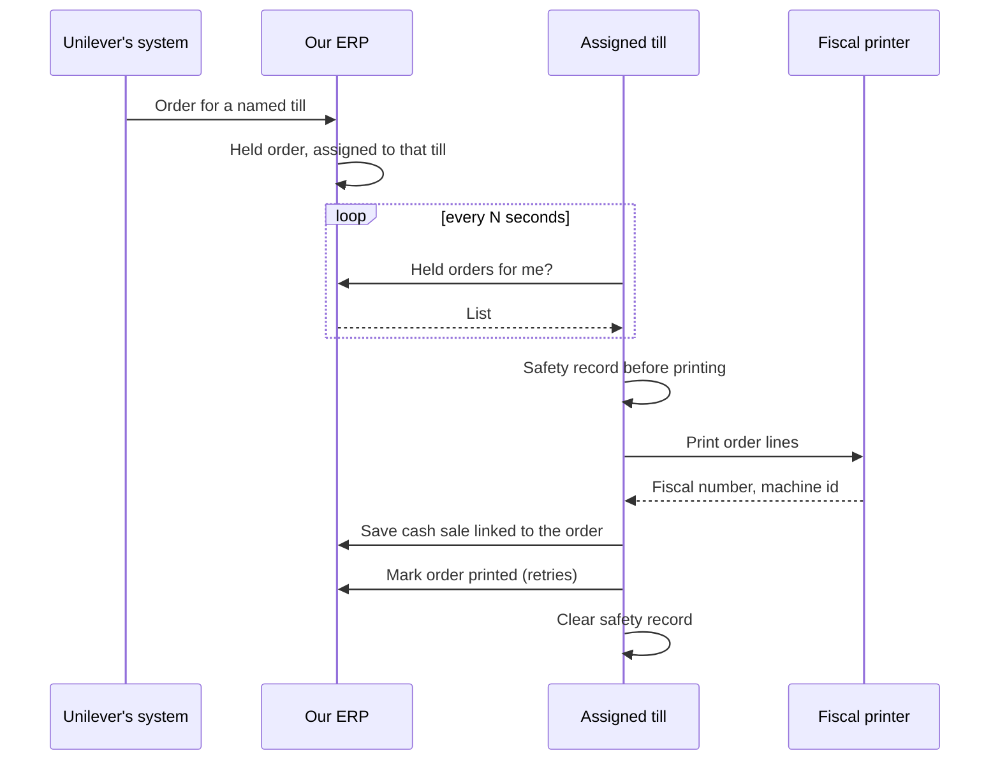

# From a Unilever order to a fiscal receipt, without staff touching it

**App:** CNDroid POS, a Flutter point-of-sale on Android fiscal devices
**My role:** I designed and built the whole app side (release 2.0.48, with follow-ups in 2.0.51 and 2.0.53). The intake that receives Unilever's orders into our ERP was built by the backend team.

---

## The problem

Unilever's ordering system places orders in our ERP, each one assigned to a specific till. That till has to fiscal-print the order and record a cash sale linked to it.

Before this work, the app had no handling for this order type. Staff would have had to open every order and convert it by hand.

## Constraints

- **A fiscal print can't be undone.** It produces a legal receipt and a fiscal number, so printing twice is a real problem, not a cosmetic one.
- **The sale needs the print's output.** The cash sale must carry the fiscal number and machine id that the printer returns.
- **Tills go offline and get switched off.** The flow must cope with network loss and restarts.
- **No new backend channel.** It had to work with the ERP's existing API.

## Architecture

1. The ERP stores each incoming order as **held** and assigns it to a till.
2. The assigned till **polls** for held orders on a timer. The interval is a per-device setting.
3. For each order the till writes the same **safety record** a normal sale writes before printing.
4. It prints, saves the cash sale with the fiscal number, then moves the order to **printed**, with up to three tries and growing waits.
5. On full success it clears the safety record.

There is also a **manual path**: staff open a held order and convert it through the normal cart.

## Key decisions and trade-offs

1. **Poll, don't push.** A timer on the till uses the existing API and needs no new infrastructure. The cost is up to one interval of delay and steady background traffic.
2. **Each till asks only for its own orders.** Two tills can never print the same order. An order assigned to a switched-off till simply waits.
3. **Print first, then save.** The sale needs the fiscal number, and the print is the one step that can't be undone. If the save then fails, the receipt exists without an ERP sale, and the safety record plus the reconciliation tools ([case study 05](05-fiscal-reconciliation.md)) take over rather than a blind retry.
4. **A "never reprint" guard.** After a successful print, the order goes into a guard that holds even if the save or state update fails. A failed order waits for a person rather than risking a second fiscal receipt.
5. **One run at a time.** A timer tick is skipped if the previous one is still running.
6. **Off when the till reads its own copy.** Automatic mode pauses in offline and LAN modes, and since 2.0.53 a tick holds the online/offline mode until it finishes, the same way an open cart does.
7. **Manual path disabled while automatic mode is on.** Two paths can't convert the same order.

## Edge cases handled

- **Network loss:** the tick is skipped; a failed list call returns nothing rather than an error loop.
- **Print fails:** the safety record is removed and the order is retried on the next tick.
- **Save fails after printing:** a clear warning, the safety record is kept, and there is no reprint.
- **State update fails:** retried with backoff, then a warning; still no reprint.
- **Mode flips mid-run:** held until the run ends.

## Problems I hit

- **Settlement flag.** When bill management was on, the auto-created sale didn't ask to be settled. Fixed in 2.0.51.
- **Mode switches mid-run.** A switch between online and device data could land in the middle of a tick. Fixed in 2.0.53 by holding the mode for the length of the run.

## Status and results

- **Shipped in 2.0.48** with both the automatic and the manual path.
- **Automatic mode needed more end-to-end testing** against the live ERP than the schedule allowed before handover. The manual path is the proven fallback.

## What I'd do next

- **Make the reprint guard survive a restart.** Today it lives in memory. Checking the safety record before printing would close the gap if the app restarts between printing and marking the order printed.
- **End-to-end tests against a staging ERP,** covering the till filter and the full print → save → mark sequence.
- **Unit tests around the sequence itself,** with a fake printer and a fake ERP, so each failure branch is exercised on every build.
