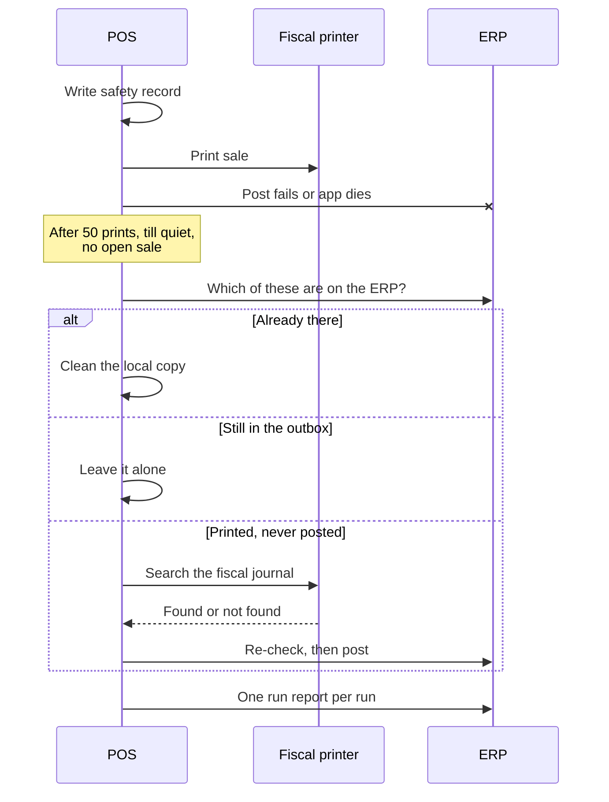

# Making the fiscal printer and the ERP agree

**App:** CNDroid POS, a Flutter point-of-sale on Android fiscal devices
**My role:** I built the automatic reconciler, the decision table, the run reports and the fixes described here (releases 2.0.44 – 2.0.54). The earlier manual tools (Day End and file-based reconcile) were built by colleagues; I extended and fixed them.

---

## The problem

A fiscal sale is printed on the device's built-in fiscal printer **before** it is posted to the ERP. If the post fails, or the app dies in between, the sale exists in the printer's memory but not in the ERP.

The result is a gap between the printer's daily Z report and the ERP's totals. Finance and branch staff then have to find the missing sales by hand.

Two manual tools already existed to repair this. Both had to be started by a person, and both had faults.

## Constraints

- **Never post a sale twice.** The normal outbox sync may be posting the same sale at the same moment.
- **Never lose the only record.** The on-device safety record may be the only proof that a sale printed.
- **Don't slow down the till.** Printer commands and log handling share one native worker thread, so a reconcile run competes with the next receipt.
- **The printer's journal is the source of truth,** but searching it is slow.

## Architecture

## Key decisions and trade-offs

1. **An explicit decision table, first match wins.** Every combination of facts about a sale maps to one of 17 outcomes, written as a pure function with 30 tests. Each case is readable and testable on its own. The cost: the table must stay in step with the code that gathers the facts.
2. **Run only when the till is quiet.** The automatic run starts after 50 fiscal prints, and only when the till has been idle for a few minutes with no sale open, so it never delays a customer's receipt.
3. **A grace period.** Sales younger than 90 minutes are left alone, so the normal sync always gets the first chance.
4. **A journal miss is not proof.** "Not found in the printer's journal" is retried, not treated as "never printed". It's safer, at the price of clearing a real never-printed case more slowly.
5. **Caps per run** on posts, printer searches and server lookups, so one run can't hog the printer.
6. **Re-check right before posting.** The "already on the server" list is built at the start of a run, but the outbox keeps working meanwhile. Each sale is checked again just before it is posted.
7. **Visible runs.** Every run, automatic or Day End, writes one report to the ERP, so finance can see what reconciliation did and when.

## Problems I hit

- **Day End was deleting sales it couldn't confirm.** When the journal search failed or found nothing, the old code still deleted the safety record, which might be the only record of a sale that printed. One try block also wrapped the whole loop, so one bad entry stopped every entry after it. Fixed: keep unconfirmed entries, isolate each entry, log every outcome.
- **Re-sending a sale that reached the server mid-run.** A classic check-then-act race, more likely once the outbox started draining on a steady timer. Fixed with the re-check before posting.
- **A regression I caused.** I changed the voucher code separator to an underscore, and the journal search pattern didn't allow underscores. Two releases shipped with codes reconcile couldn't match. A one-character fix closed it.
- **One unreadable log file stopped the run.** Now it's skipped and reported.

## Results

- Reconciliation runs by itself, without anyone remembering to start it.
- Day End no longer deletes the only record of an unconfirmed sale.
- Every run leaves a report in the ERP.
- 33 automated tests cover the reconciliation logic. Before this work there were none.

## What I'd do next

- **A direct test for the re-check race,** with a fake outbox posting in parallel. Today the tests cover the decision table, not the timing.
- **Tune the thresholds from field data.** The 50-print trigger and the 90-minute grace period are settings chosen by reasoning, not yet by measurement.
- **Server-side duplicate protection,** so the ERP rejects a second post of the same fiscal sale even if every client-side guard fails.
