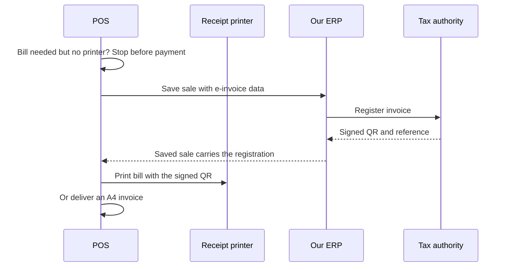

# E-invoicing with the tax authority's signed QR

**App:** CNDroid POS, a Flutter point-of-sale on Android devices
**My role:** I designed and built the whole app side (releases 2.0.45 – 2.0.54). Registering each invoice with the Ministry of Revenues system happens on our backend, which another team owns.

---

## The problem

Some businesses issue **e-invoices** registered with the Ministry of Revenues instead of printing fiscal receipts. The tax authority returns a **signed QR code** for each invoice, and the customer needs a bill or a document that carries it.

The POS was built around fiscal printing. Every sale assumed a fiscal printer. E-invoice tills had to skip all of that without breaking the normal fiscal tills that most businesses still use.

## Constraints

- **The QR comes from the tax authority, not from us.** The app can't create or fake it; it only exists after the invoice is registered.
- **Registration happens server-side.** An offline sale has no QR until it syncs.
- **Mixed hardware.** Some tills have a built-in receipt printer, some share a network printer, some have none.
- **Ethiopic script and the Ethiopian calendar** on printed documents.
- **Normal fiscal tills must not change at all.**

## Architecture

1. **E-invoice mode** saves a sale without a fiscal print, carrying the extra invoice fields on the sale and on each line.
2. The backend registers the invoice and stores the tax authority's response on the saved sale.
3. The till prints a **bill with the signed QR** on a receipt printer, or delivers an **A4 invoice** rendered on the device, with a preview.

## Key decisions and trade-offs

1. **No bill without the real QR.** The bill builder returns nothing unless the saved sale carries a registration with a QR. An offline e-invoice sale gets no bill until it syncs. That's less convenient, but the app never prints a fake or placeholder tax QR.
2. **Refuse before payment, not after.** If the bill must print and no printer is available, the sale stops *before* the customer pays. A few sales are blocked up front, but no one ever ends up paid with no bill.
3. **Pick the printer in a fixed order.** First a configured printer address, then the device's built-in printer, then the branch's single network order printer, skipping fiscal printer models. If several network printers qualify, the app asks for a setting instead of guessing.
4. **Render the A4 invoice on the device.** Native Android code lays out the page with an Ethiopic font and converts dates to the Ethiopian calendar. Delivery works without a server-side renderer, at the cost of a large piece of native layout code to maintain.
5. **Close tables without a fiscal print.** Printing a bill, splitting and merging tables all work on e-invoice tills without touching fiscal code paths.
6. **Off by default.** The e-invoice flag defaults to off, so tills that don't use it behave exactly as before.

## Edge cases handled

- **Offline:** delivery is refused with a clear message, because the sale has no saved id yet.
- **No printer:** the sale is stopped before payment.
- **Several network printers:** the app asks for a setting.
- **No fiscal printer at all:** e-invoice tills can still be set up for offline and LAN mode.
- **Merchant copy without a QR:** handled separately, so it prints on the receipt printer.

## Problems I hit

- **Payment-method handling** and the e-invoice POS mode needed follow-up fixes in the two releases after the first one.
- **Merging captain orders** in e-invoice mode would have tried a fiscal print. Closed in 2.0.54, along with splitting and bill printing on e-invoice tills.

## Results

- E-invoice tills can sell, print a bill with the tax authority's signed QR, and deliver an A4 invoice.
- 40 automated tests cover building the print data and the bill.
- The QR bill was printed on a device's built-in printer and on a network printer before handover.

## What I'd do next

- **Use the server's declared tax-inclusive amounts** on the bill, instead of recomputing them on the device. This was the planned third part.
- **Run split-bill and bill printing on real devices** across more printer models.
- **Queue bills for offline sales** and offer to print them automatically once the sale syncs and the QR arrives.
