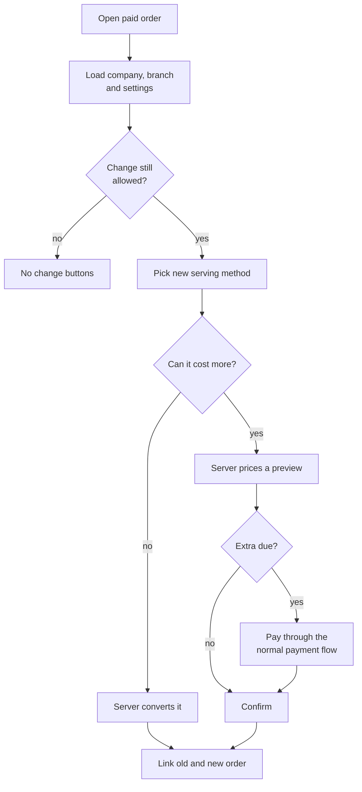

# Changing an order after you've paid

**App:** HuluBeje, a Flutter consumer super-app for ordering food, booking cinema and more (60K+ downloads on Google Play and the App Store)
**My role:** I built the whole client side (March 2026, first shipped in release 2.0.11+138). Pricing and applying the change happen on our backend, which another team owns. The payment flow and serving-method screens I built on were already in the app.

---

## The problem

Once a customer had paid, the app offered no way to change the order. A customer who ordered dine-in and then decided they wanted delivery had to phone the restaurant, and staff had to change it by hand, or cancel and refund.

## Constraints

- **Money is involved.** Some changes cost more (pickup to delivery adds a delivery fee), and the extra must be paid before the change takes effect.
- **Prices belong to the server.** The app must not calculate what a change costs.
- **Orders move on.** Once a delivery is well under way, a change no longer makes sense.
- **The order screen can open without context.** Opening an old order from history can happen with no company, branch or settings loaded in memory.

## Architecture

Six switches between dine-in, pickup and delivery, plus an address change for delivery orders. They fall into two groups.

- **Direct switches** (delivery to dine-in, pickup to dine-in, delivery to pickup): the backend applies them straight away.
- **Switches that can cost more** (dine-in to pickup, dine-in to delivery, pickup to delivery): the backend prices a preview. If nothing extra is due, the app confirms at once; otherwise the customer sees a summary, pays the difference, and the app confirms.
- **Linked history.** When a change creates a new order record, the old and new records are linked, so order history shows banners and lets the customer tap between them.

## Key decisions and trade-offs

1. **The server prices the change; the app only shows it.** No pricing rules in the client, at the cost of one extra round trip.
2. **Reuse the existing payment flow, not a second one.** One payment path to maintain. The cost is a dependency on the shared "after payment" hook that every checkout in the app uses.
3. **Reuse the serving-method screens in a "change order" mode.** Customers see the same screens and the same checks (delivery radius, for example). Those screens now carry a mode flag and skip steps that don't apply, such as scheduling.
4. **Skip payment when nothing extra is due.** A free switch takes one tap.
5. **Rebuild context before offering a change.** The app loads the company, branch and settings first. Opening an old order is slightly slower, but it can no longer fail on missing context.
6. **Store order links on the device first.** It shipped without waiting for a backend change. The cost: links don't follow the customer to a new phone.

## Edge cases handled

- Changes are blocked once a delivery has gone too far, and hidden on completed orders.
- A new delivery address outside the delivery radius is refused.
- Every preview or confirm failure shows the backend's reason.
- Pressing back on the payment screen asks for confirmation.

## Problems I hit

- **A bug I caught before it shipped.** I added cancel handling to the shared payment screen with the checks the wrong way round: the screen only cleared its busy state, and only showed errors, after a cancel. That would have affected every payment in the app, not just order changes. I found it and removed it five days later, before any release went out.
- **Settings missing when opening from history.** The first version assumed the company's settings were already loaded. A follow-up release loads them first and tightens the address checks.

## Results

- Paid customers can switch between dine-in, pickup and delivery, or change a delivery address, without calling the restaurant.
- Extra charges are priced by the server and paid in the app; free changes take one tap.
- Shipped in 2.0.11+138 (March 2026), one of the five HuluBeje releases I put out after the senior developer left.

## What I'd do next

- **Split the order-detail view model.** It grew to over 1,100 lines, and the three paid switches are near-copies. One parameterised flow would replace them.
- **Move order links to the server,** so history is the same on every device.
- **A "pending" state with retry** if the confirm step fails after a successful payment, so the customer is never left unsure.
- **Unit tests for the switch rules.** The mocking library is already in the project.
- **Typed order statuses** agreed with the backend, instead of matching display text.
