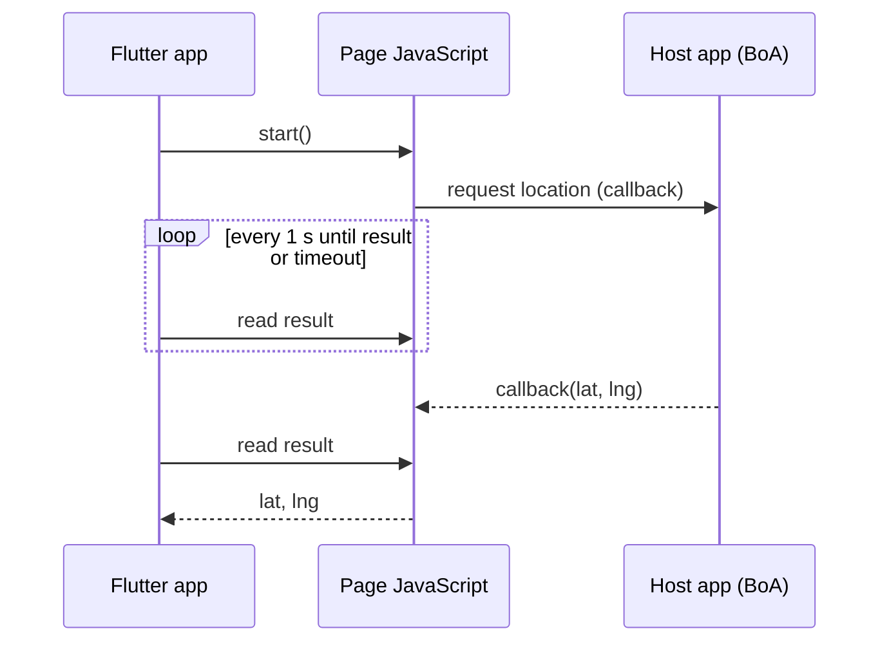

# A location bridge that never started (Bank of Abyssinia mini-app)

**App:** HuluBeje, running as a mini-app inside Bank of Abyssinia's mobile banking app · **Release:** 2.1.7+145 (April 2026) · **Built by:** me, tested with the bank's team

## Context

HuluBeje's Flutter web build runs inside partner super-apps' built-in browsers. The mini-app framework and its bridge pattern were built by the previous senior developer. My Bank of Abyssinia work was two pieces: **bank-validated single sign-on that fails closed** with a clear reason for each failure, and the location fix below. We tested both with the bank's team inside their app.

## How the bridge works

The Flutter app can't call the host app directly, so every request goes through the page's JavaScript:

## Symptom

Inside the BoA app, every location lookup came back empty. Customers were asked to "allow location", and anything that needs a position (delivery address, nearby restaurants, branch maps) had nothing to work with.

## Root cause

Two faults stacked on top of each other:

1. **The request never started.** On the first attempt the Flutter side called the "read result" step instead of "start", so nothing ever reached the host. The poll then timed out on an empty result.
2. **The script assumed an instant answer.** Even when started, the old JavaScript expected the host to return coordinates immediately. The BoA app answers later, through a callback. The script also accepted `0, 0` as a valid position.

## Fix

- Call **start** first, then poll for the result.
- Use the host's **callback bridge** when it has one, and a direct call otherwise.
- Accept **both naming styles** hosts use for coordinates.
- **Reject** missing, non-numeric and zero coordinates.
- **Block a second request** while one is in flight.
- **Close the host's location screen** after a successful read.

## Trade-off and what's next

The fix keeps the existing polling bridge (one-second checks, ten-second limit), because every partner integration depends on it. A failure still shows a generic "allow location" message. Next I'd return a specific reason (denied, timed out, host not supported) and move the bridge from polling to a promise-based call, so results arrive the moment the host answers.
